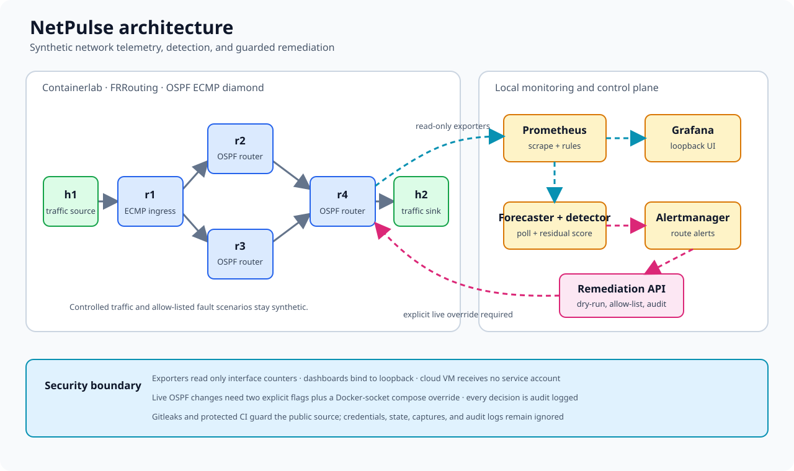

# NetPulse

Simulated network telemetry, leakage-aware link-utilisation forecasting, anomaly detection, and guarded auto-remediation.

> Status: Tasks 1–13 are implemented with source-backed local evidence, GCP live-deployment
> acceptance, CI, full-history secret scanning, reproducible lifecycle commands, and a captured
> live-stack demo. GCP project identifiers, billing details, addresses, local state, and operator
> credentials remain outside this repository. A live remediation test requires explicit operator
> enablement.

## Scope

NetPulse uses Containerlab and FRRouting to create a small synthetic network. It generates controlled traffic and link-failure events, observes router-interface telemetry with Prometheus and Grafana, predicts next-interval link utilisation, and routes alerts through Alertmanager to a protected remediation service.

Synthetic topology and traffic are demonstration data, not operator-network data. Reported forecast, anomaly, and MTTR results will be generated from saved runs; no values are pre-claimed.

## Delivery target

Delivery window: 15–20 November 2026.

GCP deployment is required final-stage work. Local Linux validation comes first because Containerlab needs Linux networking; Terraform then deploys the runnable system to a GCP Compute Engine Linux VM. GCP project ID, billing approval, and credentials stay outside this repository.

## Prerequisites

- Python 3.11 or 3.12 for project dependencies
- Linux host or Linux VM for Containerlab execution
- Docker and Docker Compose (used from Task 2 onward)
- Terraform 1.9+ and a GCP project with an approved budget for Task 11 deployment

## Foundation setup

```bash
python3.11 -m venv .venv
source .venv/bin/activate
python -m pip install --upgrade pip
python -m pip install -e ".[dev]"
cp .env.example .env
make check
```

`NETPULSE_DRY_RUN=true` is default. Do not put GCP credentials, Terraform variables, Grafana state, fault captures, or remediation audit logs in Git.

## Linux quick start

Run this on a prepared **Linux** host, Linux VM, or the repository's Linux devcontainer. It needs
Python 3.11 or 3.12, Docker with Compose v2, Containerlab, `make`, and `curl`; the command checks
each prerequisite before making changes. It creates a local virtual environment, copies `.env`
only when it does not already exist, then validates the code, deploys the synthetic topology,
checks OSPF/ECMP, and starts monitoring.

```bash
git clone https://github.com/Sid09-eng/network-telemetry.git
cd network-telemetry
make quickstart
```

Expected final output includes `Topology healthy: all OSPF adjacencies Full; r1 has two ECMP paths
to h2.` and `NetPulse is ready`. Open Grafana at `http://127.0.0.1:3000`; its local credentials
come from the ignored `.env` file. On macOS, run these commands from the Linux devcontainer rather
than the macOS host terminal.

For a transparent equivalent (useful when diagnosing a prerequisite), the lifecycle command runs:

```bash
python3 -m venv .venv
source .venv/bin/activate
python -m pip install --upgrade pip
python -m pip install -e ".[dev]"
cp .env.example .env  # only if .env does not already exist
make check
make topology-up
make topology-check
make monitoring-up
curl --fail http://127.0.0.1:9090/-/ready
```

## Teardown

Stop the local monitoring containers and remove only the local Containerlab lab:

```bash
make teardown
```

`make teardown` expands to `make monitoring-down` followed by `make topology-down`; it does not
delete the repository, virtual environment, or GCP resources. If you deliberately provisioned the
optional GCP VM and no longer need it, review the Terraform plan and then run this separate,
destructive cloud cleanup command from the repository root:

```bash
terraform -chdir=infra/terraform destroy
```

That command destroys the Terraform-managed GCP VM, VPC, subnet, and firewall resources. It does
not affect local Docker or Containerlab resources.

## Continuous integration and secret scanning

GitHub Actions runs on pushes and pull requests to `main`. It installs Python development
dependencies, lints and tests the project, validates Compose syntax, builds service and
traffic-host images, and runs Terraform formatting/validation with no cloud credentials or
`terraform apply`. A separate Gitleaks job scans the full reachable Git history. Dependabot
opens weekly update pull requests for GitHub Actions and Python dependencies. Container-image
pins are changed only through an explicit, tested compatibility update.

Containerlab is deliberately excluded from hosted CI: its smoke test needs a stable privileged
Linux runner. Run the topology acceptance checks from the Linux devcontainer or the GCP host.

## Telemetry contract

Each FRR router has fixed management IP (`172.20.20.11`–`172.20.20.14`). Task 4 starts a small exporter sidecar in each router network namespace. Exporter reads only listed data-plane interface counters from `/sys/class/net`, exposes port `9100`, and never executes router commands.

Prometheus scrapes raw byte, packet, error, and drop counters. [Recording rules](monitoring/recording_rules.yml) derive one-minute bits-per-second and utilisation ratios; raw counters stay raw. Default link capacity is 100 Mbps and is explicit in `NETPULSE_LINK_CAPACITY_BPS`.

## Available commands

```bash
make help
make test
make lint
make check
make topology-up
make topology-check
make topology-down
make monitoring-up
make monitoring-down
make terraform-fmt
make terraform-validate
```

## macOS Containerlab development

This repository includes a Docker-outside-Docker Linux devcontainer at [`.devcontainer/devcontainer.json`](.devcontainer/devcontainer.json). In VS Code, install **Dev Containers**, open this folder, then run **Dev Containers: Reopen in Container**. The first launch pulls `ghcr.io/srl-labs/containerlab/devcontainer-dood-slim:0.83.0`.

Run topology commands from VS Code's devcontainer terminal, not macOS Terminal:

```bash
containerlab version
make topology-up
make topology-check
make topology-down
```

`topology-up` creates two equal-cost OSPF paths between `h1` and `h2`; `topology-check` requires each router to have two Full neighbours and `r1` to have two next hops to `10.0.4.0/24`.

## Monitoring stack

After `make topology-up` and a successful `make topology-check`, run `make monitoring-up`.
Compose starts Prometheus, Grafana, Alertmanager, detector, guarded remediation API, and one
read-only metrics exporter in each router network namespace. Containerlab remains owned by
the topology targets; `make monitoring-down` does not destroy it. Grafana is available only
on `http://127.0.0.1:3000` and is declaratively provisioned with the NetPulse Prometheus
datasource and Link Overview dashboard. Default local credentials are `admin` /
`netpulse-local-only`; set `GRAFANA_ADMIN_PASSWORD` in `.env` before exposing the stack.

The devcontainer runs as `root`, is privileged, and mounts Docker runtime paths plus your Docker Desktop socket. Docker Desktop does not expose `/run/docker/netns`, so that native-Linux-only mount is intentionally omitted. Open this only for the trusted repository: it can control Docker Desktop containers and networks.

Terraform defines a single labelled Compute Engine VM, a dedicated VPC/subnet, and an SSH firewall
restricted to your `admin_cidr`. It has no committed project ID, credentials, local state, billing
configuration, and explicitly attaches no VM service account. Grafana remains loopback-only and is accessed over
an SSH tunnel. Run `make terraform-fmt` and `make terraform-validate` locally, then follow the
reviewed [GCP deployment guide](docs/gcp-deployment.md) before any `plan` or `apply`. See the
[foundation plan](docs/plans/netpulse-foundation-plan.md) for ordered acceptance criteria.

## Traffic and faults

Task 5 provides a deterministic 24-bucket compressed-day UDP traffic plan and an allow-listed
diamond-link fault scenario. Both commands are dry-run by default. The topology target builds
the local traffic-host image with `iperf3` before deployment.

```bash
# Print a repeatable traffic plan; add --apply only to send UDP traffic from h1 to h2.
python traffic/generate.py --seed 17 --duration-seconds 120 \
  --target-rate-mbps 25 --scenario-id diamond-failover

# Record planned outage/recovery events without changing links.
python traffic/faults.py --scenario traffic/scenarios/diamond-failover.yaml \
  --log-path runs/diamond-failover-faults.jsonl
```

Use `--apply` on either command only for a controlled experiment. Fault application changes both
endpoints of a fixed inter-router link and writes an `applied` or `unapplied` JSONL record; it
never claims a failed command was injected. If endpoint compensation also fails, the record is
explicitly marked `partial-failure` with its rollback outcome.

## Forecast evaluation

Train only from a completed immutable run. The evaluator builds features using observations
through time *t*, predicts the next interval, and reports rolling-origin future-time metrics
separately from leave-one-link-out transfer metrics.

```bash
python -m forecast.train --run-dir runs/task7-variable-traffic-20261115
```

The plain command is evaluation-only: it writes the forecast report but does not change detector
state. To publish the optional detector handoff to a locally running monitoring stack:

```bash
python -m forecast.train --run-dir runs/task7-variable-traffic-20261115 \
  --detector-url http://127.0.0.1:8001
```

That command selects its threshold from earlier rolling-origin validation residuals, then scores
and publishes only the final chronological fold. It therefore does not use the targets being
scored to choose the threshold. Detector publishing requires at least two rolling-origin folds;
add `--detector-dry-run` to calculate the payloads without sending HTTP requests.

The committed report is source-backed by that run, but remains a short synthetic experiment—not
an operator-network performance claim.

## Guarded remediation

Alertmanager sends `NetPulseLinkAnomaly` alerts to the local FastAPI remediation webhook. The
service accepts only the fixed OSPF link allow-list (`r1-r2`, `r1-r3`, `r2-r4`, and `r3-r4`),
serializes decisions, applies a monotonic per-interface cooldown, and appends audit JSONL records.
Its Prometheus endpoint exports remediation status counters and last-action latency.

Dry-run is the default. It records the exact allow-listed `docker exec ... vtysh` command but
never invokes Docker or changes a router. Test the webhook locally with:

```bash
curl --fail -X POST http://127.0.0.1:8000/alerts \
  -H 'Content-Type: application/json' \
  --data '{"version":"4","status":"firing","alerts":[{"status":"firing","labels":{"alertname":"NetPulseLinkAnomaly","link":"r1-r2"}}]}'
curl http://127.0.0.1:8000/metrics
```

Live OSPF cost changes require both `NETPULSE_DRY_RUN=false` and
`NETPULSE_ENABLE_LIVE_ACTIONS=true` in ignored `.env`; either setting alone is insufficient.
They additionally require the explicit socket-mount override, `make monitoring-live-up`. The
normal `make monitoring-up` dry-run stack does not mount the Docker socket. Do not enable live
mode until you have approved a controlled reroute test and a rollback/teardown plan.

## Architecture



The [architecture SVG](docs/architecture.svg) is self-contained and describes the synthetic
diamond topology, telemetry path, detection path, and guarded remediation boundary.

## Observed demo flow

The checked-in [demo GIF](docs/demo.gif) was captured from a verified live Linux run on 16
November 2026. It displays command output taken from the running services—not invented sample
values—and follows this flow:

1. `make topology-check` verifies four OSPF routers have Full adjacencies and `r1` has two ECMP
   paths to `h2`.
2. Prometheus `/-/ready` confirms the scrape server is ready; its API reports the active NetPulse
   targets.
3. Grafana's live `/api/health` response confirms the provisioned dashboard service and database
   are healthy. The dashboard itself is opened locally at `http://127.0.0.1:3000`.
4. A Prometheus query displays recorded transmit-throughput/utilisation data exported from router
   namespaces. The flow remains dry-run: it does not inject a fault or change an OSPF cost.

## Evidence and provenance

| Evidence | Source and interpretation |
| --- | --- |
| Topology acceptance | `scripts/check_topology.py` queries the live FRR routers; the GIF records its successful OSPF/ECMP output. |
| Monitoring evidence | Prometheus readiness, target, and recording-rule queries are fetched from the live local API. Grafana health is fetched from its live local API. |
| Forecast/anomaly/MTTR experiments | Immutable run folders under `runs/task10-*`, their manifests/hashes, and [MTTR results](results/mttr_metrics.md) are the experiment record. They are synthetic controlled experiments, not production SLO evidence. |
| Automated verification | **70 automated tests** are run by `make test`; `make lint` runs Ruff. The [GitHub Actions workflow](.github/workflows/ci.yml) additionally validates Compose, Terraform, and reachable Git history with Gitleaks. |
| Deployment evidence | [GCP deployment guidance](docs/gcp-deployment.md) documents the reviewed, loopback-only deployment acceptance without committing cloud identifiers or credentials. |
| Demo asset | [docs/demo.gif](docs/demo.gif) is generated after the live checks above; it includes the capture timestamp and direct endpoint output so its provenance can be independently inspected. |

## Limitations

- NetPulse models a small, synthetic FRR diamond; results do not demonstrate performance on an
  operator network or under Internet-scale traffic.
- Containerlab needs privileged Linux networking. Hosted CI intentionally does not run the live
  topology smoke test; it is run from a Linux devcontainer or the GCP host.
- The recorded experiments are finite and scenario-specific. Forecast quality, anomaly thresholds,
  and MTTR do not generalise without new representative data and controlled validation.
- The GIF verifies live service health and metrics endpoints. It is an evidence snapshot, not a
  substitute for the immutable experiment artifacts or an ongoing monitoring record.

## Security boundary

- Remediation is dry-run by default. A live OSPF change requires both explicit environment flags
  and the separate `make monitoring-live-up` socket-mount override.
- Router/link actions are allow-listed, serialized, cooldown-protected, and audit logged. Exporters
  read interface counters only; they do not execute router commands.
- Grafana, Prometheus, Alertmanager, detector, and remediation ports bind to loopback by default.
  The GCP design permits SSH only from the supplied administrator CIDR and attaches no VM service
  account.
- `.env`, Terraform state/variables, audit logs, captures, and cloud credentials are ignored. CI
  scans reachable history with Gitleaks; protected `main` requires its CI checks before merge.
